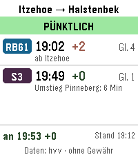
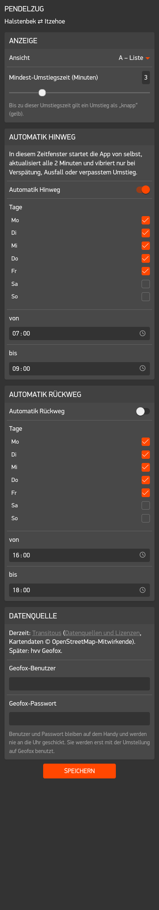

# Pendelzug


Watchapp für die **Pebble Time 2**. Sie zeigt auf einen Blick, ob die
Bahnverbindung pünktlich ist und ob die Umstiege klappen. Start und Ziel sind
frei wählbar (Standard: Halstenbek ⇄ Itzehoe).

**Im Pebble-Store (nicht gelistet, nur per Link):** <https://apps.repebble.com/b7e5b4b47e684f52b75448df>

> **Version 1.1.0.** **Stand:** Schritt 6 – echte Verbindungen vom HVV (Geofox) mit Echtzeit,
> Linienfarben, Einstellungsseite mit frei wählbarem Start und Ziel, Automatik mit Wakeup und
> Vibration. Als Nächstes: eigener Server, damit alle Nutzer HVV-Daten bekommen (siehe „Datenquelle“).

Echte Verbindung im Emulator (hvv Geofox, 03.11.2026):



**Ansicht A – Liste** (Standard), in drei der vier Test-Zustände:


**Ansicht B – Ankunft groß** und **Ansicht C – Nächster Schritt**:


## Bedienung

| Taste | Funktion |
|---|---|
| Auf / Ab | frühere / spätere Verbindung |
| Select | neu laden |
| Select lang (≥ 0,7 s) | Richtung umschalten (Hinweg ⇄ Rückweg) |
| Zurück | App schließen |

Die Richtung wird beim Start nach der Tageszeit gewählt: vormittags Hinweg,
ab 12 Uhr Rückweg. Beim Öffnen zeigt die App die zuletzt angesehene
Verbindung, solange sie noch unterwegs ist (z. B. nach dem Einsteigen),
sonst die nächste.

**Keine Echtzeit:** Hat ein Zug (noch) keine Echtzeitdaten, steht seine
Plan-Zeit grau und ohne „+0“ da – „+0“ würde „pünktlich“ behaupten. Hat kein
Zug der Verbindung Echtzeit, ist das Statusband grau mit „KEINE ECHTZEIT“.

**Linienfarben:** S-Bahn, Regionalbahn und Regionalexpress haben ihre eigenen
Farben (z. B. S3 violett, RB61 blau, RE6 grün), unbekannte Linien und Busse
sind grau. Die Tabelle steht in `src/pkjs/linienfarben.js`.

**Umstiegszeit** = Zeit von der Ankunft des einen bis zur Abfahrt des nächsten
Zugs, ein Fußweg dazwischen zählt mit. Höchstens 3 Minuten gelten als „knapp“,
negativ als „verpasst“.

**Testbetrieb:** Steht in `src/embeddedjs/main.js` `TESTBETRIEB = true`, zeigt
die App feste Testdaten. Dann blättern Auf/Ab durch vier Test-Zustände
(pünktlich, Umstieg knapp, Anschluss weg, Warten am Umstieg) und Select wechselt
die Ansicht (A → B → C).

## Automatik

- **Start:** Zum Anfang eines Automatik-Fensters öffnet die Uhr Pendelzug von
  selbst (Wakeup) und zeigt die Richtung dieses Fensters.
- **Aktualisierung:** Solange ein Fenster läuft und die App offen ist, lädt sie
  alle 2 Minuten neu – auch wenn du sie selbst geöffnet hast.
- **Vibration** nur im Fenster und nur bei automatischen Abfragen:
  - zweimal kurz: Verspätung am Ziel
  - einmal lang: Ausfall oder Anschluss verpasst

  Pro Problem nur einmal. Erneut nur, wenn es schlimmer wird (Ausfall statt
  Verspätung, oder mindestens 5 Minuten mehr Verspätung). Ein nur knapper
  Umstieg vibriert nicht.
- **Ende:** Hat die Automatik die App geöffnet, schließt sie sich am
  Fensterende wieder.
- Schließt du die App im Fenster, bleibt sie zu. (Alloy-Apps können nicht im
  Hintergrund laufen; ein Wakeup öffnet die App immer sichtbar.)

## Einstellungen

In der Pebble-App auf dem Handy über das Zahnrad bei Pendelzug:

- **Start und Ziel:** ein paar Buchstaben tippen, dann einen Vorschlag antippen.
  Übernommen werden nur Haltestellen aus der Vorschlagsliste; frei getippter
  Text wird beim Verlassen des Feldes verworfen. Bahnhöfe und Haltestellen in
  der Nähe (der jeweils anderen gewählten Haltestelle) stehen oben, doppelte
  Einträge werden zusammengefasst. Hinweg = Start → Ziel, Rückweg umgekehrt.
  Ist der Name für die Kopfzeile der Uhr zu lang, wird er mit „…“ gekürzt.
- **Ansicht:** A – Liste (Standard), B – Ankunft groß, C – Nächster Schritt
- **Mindest-Umstiegszeit:** 1–10 Minuten (Standard 3)
- **Automatik Hinweg / Rückweg:** an/aus, Wochentage, Zeitfenster
  (Standard: Hinweg Mo–Fr 07:00–09:00, Rückweg aus), siehe unten.
- **Geofox-Benutzer und -Passwort:** bleiben auf dem Handy, werden nie an die
  Uhr geschickt. Sind beide ausgefüllt, kommen die Verbindungen vom HVV
  (siehe „Datenquelle“).



**Im Emulator:** App starten, dann

```sh
./pebble.sh einstellungen
```

Die Seite öffnet sich in deinem Browser. Nach „Speichern“ gehen die Werte an
die App im Emulator. Das Pebble-Werkzeug würde dabei alle Werte samt Passwort
ins Terminal schreiben; `pebble.sh` filtert diese Zeile heraus.
**Achtung:** `./pebble.sh install` löscht im Emulator manchmal die gespeicherten
Einstellungen – dann Benutzer und Passwort erneut eintragen. (Dafür nutzt der Container das Netz deines Rechners,
siehe `pebble.sh`.)

## Datenquelle

Die Verbindungen kommen vom **HVV über die Schnittstelle
[Geofox GTI](https://gti.geofox.de/html/GTIHandbuch_p.html)** (betrieben von
der HBT GmbH), mit Echtzeitdaten: Verspätungen, Ausfälle, Gleiswechsel.

- Geofox braucht Zugangsdaten (Benutzer und Passwort), die man beim HVV
  beantragt. Sie werden auf der Einstellungsseite eingetragen, bleiben auf dem
  Handy und stehen **nie im Code oder im Repository**.
- Jede Anfrage wird signiert: HMAC-SHA1 über den Inhalt der Anfrage, mit dem
  Passwort als Schlüssel (`src/pkjs/hmac-sha1.js`).
- Nutzungsbedingungen, kurz: App bleibt kostenlos, Serverlast gering halten
  (die App merkt sich Ergebnisse 90 Sekunden und die Haltestellen dauerhaft),
  hvv-Liniendarstellung verwenden.

**Ohne Geofox-Zugangsdaten** nutzt die App übergangsweise
[Transitous](https://transitous.org) (freier Fahrplandienst;
[Datenquellen und Lizenzen](https://transitous.org/sources/), Kartendaten ©
[OpenStreetMap](https://www.openstreetmap.org/copyright)-Mitwirkende). Auch die
Vorschlagssuche für Start und Ziel läuft noch über Transitous. Geplant ist ein
eigener Server auf wortreich.eu, über den alle Nutzer HVV-Daten bekommen;
danach entfällt Transitous.

Der Handy-Teil ist in Adapter (`geofox.js`, `transitous.js`) und
quellenunabhängige Aufbereitung (`aufbereitung.js`) getrennt. Unten auf der Uhr
steht, woher die Daten kommen („Daten: hvv“ bzw. „Daten: Transitous“).

### Testskripte für Geofox (auf dem Rechner, nicht auf der Uhr)

Zugangsdaten liegen dafür in `~/.pendelzug-gti` (außerhalb des Projekts):

```
GTI_USER=…
GTI_PASS=…
```

```sh
node tools/gti-test.js            # Verbindungstest (Methode init)
node tools/gti-route.js           # Verbindungen Halstenbek → Itzehoe ab jetzt
node tools/gti-route.js rueck 16:30   # Rückweg ab 16:30
node tools/hmac-test.js           # prüft die Signatur der App gegen Node-crypto
```

Die vollständigen Antworten landen in `tools/ausgabe/` (von git ignoriert).

## Technik

- [Alloy](https://developer.repebble.com/guides/alloy/) (JavaScript auf der Uhr) mit dem Oberflächen-Framework Piu
- Zielplattform: emery (Pebble Time 2, 200 × 228 Pixel, 64 Farben)
- Pebble-SDK und Emulator laufen in einem **Docker-Container**, weil der
  Emulator glibc 2.38 oder neuer braucht (Debian 12 / MX Linux 23 hat nur 2.36)

## Bauen und im Emulator starten

Voraussetzung: Docker ist installiert und dein Benutzer ist in der Gruppe
`docker` (prüfen mit `groups`).

### Einmalig: Erlaubnis für das Emulator-Fenster

Der Emulator läuft im Container, sein Fenster soll aber auf deinem Bildschirm
erscheinen. Dafür muss dein X-Server (das Programm, das unter Linux die Fenster
zeichnet) Verbindungen von deinem eigenen Benutzer zulassen. Prüfen:

```sh
xhost
```

Steht dort `SI:localuser:<dein Benutzername>`, ist alles in Ordnung. Wenn nicht:

```sh
xhost +SI:localuser:$USER
```

Das gilt bis zum Abmelden und muss danach erneut eingegeben werden.
Bitte **nicht** `xhost +` ohne Zusatz verwenden, das würde jedem Programm im
Netzwerk Zugriff auf deinen Bildschirm geben.

### Bauen und starten

Alle Befehle im Projektordner. `./pebble.sh` funktioniert genau wie der
normale `pebble`-Befehl, nur läuft er im Container:

```sh
./pebble.sh build                      # App bauen
./pebble.sh install --emulator emery   # im Emulator installieren und starten
./pebble.sh logs --emulator emery      # Log-Ausgaben ansehen (Strg+C beendet)
./pebble.sh screenshot --no-open --emulator emery screenshots/bild.png
./pebble.sh einstellungen              # Einstellungsseite im Browser öffnen
./pebble.sh stop                       # Container und Emulator beenden
```

Beim allerersten Aufruf baut das Skript das Docker-Image. Das dauert einige
Minuten, weil SDK und Werkzeuge heruntergeladen werden.

Hängt der Emulator: `./pebble.sh kill`, dann `./pebble.sh wipe`, dann neu installieren.

## Projektaufbau

```
src/embeddedjs/main.js        Uhr-Code: Ansichten A, B, C (Piu)
src/embeddedjs/testdaten.js   vier Beispiel-Verbindungen für den Testbetrieb
src/embeddedjs/automatik.js   Regeln für Automatik-Fenster und Vibration
src/embeddedjs/manifest.json  Liste der JavaScript-Module der Uhr
src/pkjs/index.js             Handy-Code (PKJS): Anfragen der Uhr beantworten
src/pkjs/konfig.js            Standard-Haltestellen, Kontakt, Zwischenspeicher-Dauer
src/pkjs/config.js            Aufbau der Einstellungsseite (Clay)
src/pkjs/haltestelle-feld.js  Clay-Feld „Haltestelle“ mit Vorschlagssuche
src/pkjs/einstellungen.js     Einstellungen lesen, Teil für die Uhr (ohne Zugangsdaten)
src/pkjs/geofox.js            Adapter für die Verbindungssuche beim HVV (Geofox GTI)
src/pkjs/hmac-sha1.js         Signatur für Geofox-Anfragen
src/pkjs/linienfarben.js      Farben der Linien-Badges
src/pkjs/transitous.js        Adapter für Transitous (Ersatz ohne Geofox-Zugang)
src/pkjs/aufbereitung.js      Umstiege, Ampel, Paket für die Uhr (quellenunabhängig)
src/c/mdbl.c                  startet JavaScript auf der Uhr (Speichergrößen)
package.json                  App-Daten: Name, UUID, Plattformen
docker/Dockerfile             Entwicklungsumgebung (Ubuntu 24.04 + Pebble-SDK)
resources/images/menu_icon.png Symbol im Menü der Uhr (25×25)
store/                        Logo, Store-Screenshots, Texte für den Pebble-Store
docker/browser.sh             Browser-Ersatz im Container (für die Einstellungsseite)
pebble.sh                     Startskript für die Docker-Umgebung
tools/                        Testskripte für Geofox (Node.js, auf dem Rechner)
```

## Lizenz

Pendelzug steht unter der **GNU General Public License, Version 3 oder neuer**
(GPL-3.0-or-later), siehe [LICENSE](LICENSE). Kurz gesagt: Jeder darf den Code
nutzen, ändern und weitergeben. Wer eine veränderte Version weitergibt, muss
deren Quellcode ebenfalls unter der GPL offenlegen.
