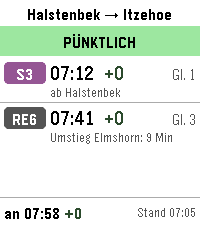
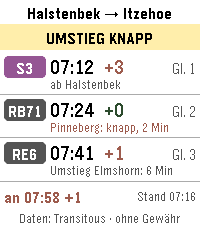
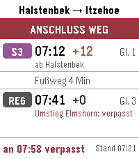
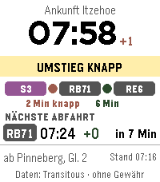
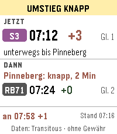

# Pendelzug

Watchapp für die **Pebble Time 2**. Sie zeigt auf einen Blick, ob die
Bahnverbindung Halstenbek ⇄ Itzehoe pünktlich ist und ob die Umstiege klappen.

> **Stand:** Schritt 2 – Ansichten A, B und C mit fest eingebauten Testdaten.
> Echte Verbindungsdaten folgen in Schritt 3.

**Ansicht A – Liste** (Standard), in den drei Test-Zuständen:





**Ansicht B – Ankunft groß** und **Ansicht C – Nächster Schritt**:




## Bedienung

| Taste | Funktion (Testbetrieb, Schritt 2) |
|---|---|
| Auf / Ab | zwischen den drei Test-Zuständen blättern |
| Select | nächste Ansicht (A → B → C); ab Schritt 4 wird die Ansicht in den Einstellungen gewählt |
| Zurück | App schließen |

## Technik

- [Alloy](https://developer.repebble.com/guides/alloy/) (JavaScript auf der Uhr) mit dem Oberflächen-Framework Piu
- Zielplattform: emery (Pebble Time 2, 200 × 228 Pixel, 64 Farben)
- Pebble-SDK und Emulator laufen in einem **Docker-Container**, weil der
  Emulator glibc 2.38 oder neuer braucht (Debian 12 / MX Linux 23 hat nur 2.36)

## Bauen und im Emulator starten

Voraussetzung: Docker ist installiert und dein Benutzer ist in der Gruppe
`docker` (prüfen mit `groups`).

### Einmalig: Erlaubnis für das Emulator-Fenster

Der Emulator läuft im Container, sein Fenster soll aber auf deinem Bildschirm
erscheinen. Dafür muss dein X-Server (das Programm, das unter Linux die Fenster
zeichnet) Verbindungen von deinem eigenen Benutzer zulassen. Prüfen:

```sh
xhost
```

Steht dort `SI:localuser:<dein Benutzername>`, ist alles in Ordnung. Wenn nicht:

```sh
xhost +SI:localuser:$USER
```

Das gilt bis zum Abmelden und muss danach erneut eingegeben werden.
Bitte **nicht** `xhost +` ohne Zusatz verwenden, das würde jedem Programm im
Netzwerk Zugriff auf deinen Bildschirm geben.

### Bauen und starten

Alle Befehle im Projektordner. `./pebble.sh` funktioniert genau wie der
normale `pebble`-Befehl, nur läuft er im Container:

```sh
./pebble.sh build                      # App bauen
./pebble.sh install --emulator emery   # im Emulator installieren und starten
./pebble.sh logs --emulator emery      # Log-Ausgaben ansehen (Strg+C beendet)
./pebble.sh screenshot --no-open --emulator emery screenshots/bild.png
./pebble.sh stop                       # Container und Emulator beenden
```

Beim allerersten Aufruf baut das Skript das Docker-Image. Das dauert einige
Minuten, weil SDK und Werkzeuge heruntergeladen werden.

Hängt der Emulator: `./pebble.sh kill`, dann `./pebble.sh wipe`, dann neu installieren.

## Projektaufbau

```
src/embeddedjs/main.js        Uhr-Code: Ansichten A, B, C (Piu)
src/embeddedjs/testdaten.js   drei Beispiel-Verbindungen (bis Schritt 3)
src/embeddedjs/manifest.json  Liste der JavaScript-Module der Uhr
src/pkjs/index.js             Handy-Code (PKJS), später Verbindungssuche
src/c/mdbl.c                  startet JavaScript auf der Uhr (Speichergrößen)
package.json                  App-Daten: Name, UUID, Plattformen
docker/Dockerfile             Entwicklungsumgebung (Ubuntu 24.04 + Pebble-SDK)
pebble.sh                     Startskript für die Docker-Umgebung
```

## Lizenz

Noch nicht festgelegt (wird vor einer Veröffentlichung entschieden).
